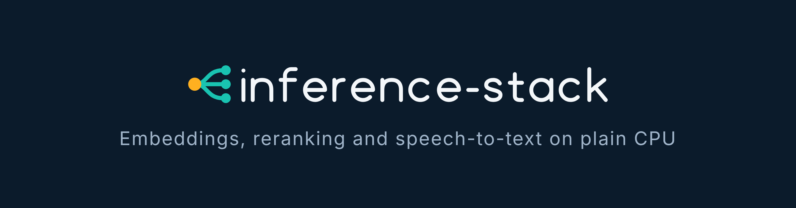

<p align="center">
  
</p>

<p align="center">
  <a href="https://github.com/layer87-labs/inference-stack/releases"></a>
  <a href="https://github.com/layer87-labs/inference-stack/actions/workflows/ci.yml"></a>
  <a href="go.mod"></a>
  <a href="LICENSE"></a>
</p>

# inference-stack

**inference-stack** is a small OpenAI-compatible router in front of CPU-only inference backends. One endpoint
gives you **embeddings** (`BAAI/bge-m3` via [TEI](https://github.com/huggingface/text-embeddings-inference)),
**reranking** (a cross-encoder via TEI/ONNX) and **speech-to-text** (Whisper `large-v3-turbo` via
[faster-whisper](https://github.com/SYSTRAN/faster-whisper)). It runs on plain CPU and RAM. No GPU needed.

**Why it exists.** Search, RAG and transcription should not need a GPU budget or a pile of glue code. We
([Layer87](https://github.com/layer87-labs)) needed exactly this in our own applications, built it, run it ourselves
and open-sourced it. It ships with hardened container images, a Helm chart and signed releases.

## Highlights

- **One API, three capabilities.** `/v1/embeddings`, `/v1/rerank`, `/v1/audio/transcriptions`, plus a merged `/v1/models`
  that also reports the backends' request limits.
- **CPU only.** Sized and measured on CPU; the numbers (latency per rerank request, memory, real-time factor) are in
  [docs/tuning.md](docs/tuning.md).
- **Backends are optional.** All are off by default; enable only what you need.
- **Backpressure instead of pile-ups.** Per-backend concurrency bound; above it the router answers `503` with
  `Retry-After` right away ([details](docs/configuration.md#backpressure)).
- **Observable.** Prometheus metrics on a separate port, JSON logs, optional `ServiceMonitor` and `NetworkPolicy`.
- **Signed images.** Released images are signed keyless with [cosign](https://github.com/sigstore/cosign) via GitHub
  OIDC ([verify](#security)).
- **Hardened by default.** Non-root containers, no privilege escalation, all capabilities dropped, `RuntimeDefault`
  seccomp, executable-stack flag cleared on the ONNX Runtime libraries of the TEI base image.
- **Offline at runtime.** Models are baked into images (`HF_HUB_OFFLINE=1`); model volumes are mounted read-only.
- **Pinned build inputs.** The Whisper image pins its base image by digest, all Python dependencies, the model
  revision and the model file's SHA-256; the build fails if any of them changes.
- **Per-component CalVer releases.** Router, TEI images, models, Whisper and the Helm chart are released
  independently with [relctl](https://github.com/layer87-labs/relctl).

## Architecture

```
                        ┌──────────────────────────────────────┐
  your app ──HTTP──▶    │  inference-router   (Go, :8080)      │ ─▶ :9090/metrics
  OpenAI-style API      └───────┬───────────────┬──────────────┘
                                │               │               │
                   /v1/embeddings         /v1/rerank     /v1/audio/transcriptions
                                ▼               ▼               ▼
                        ┌────────────┐  ┌────────────┐  ┌──────────────────┐
                        │ TEI        │  │ TEI (ONNX) │  │ faster-whisper   │
                        │ bge-m3     │  │ cross-enc. │  │ large-v3-turbo   │
                        └─────▲──────┘  └─────▲──────┘  └──────────────────┘
                              │ /model (ro)   │ /model (ro)   model baked into image
                      model-init (rsync)  model-init (rsync)
```

The router is a pure reverse proxy: it routes by path, bounds concurrency, probes backend health and exports
metrics. It contains no model logic. The TEI backends read their model from a volume that an init container
fills from a model baked into its image (idempotent, `rsync --ignore-existing`); Whisper has the model in the
image itself.

## Quick start

**Try it locally in a minute** (mock backends, no models, needs Go):

```bash
make test-local          # builds, starts mock backends + router, runs the end-to-end checks
```

Or start the pieces by hand and call the API yourself:

```bash
make build
MOCK_TYPE=embedding MOCK_PORT=9101 build/bin/mock-backend &
EMBEDDING_ENABLED=true EMBEDDING_URL=http://localhost:9101 build/bin/inference-router &

curl http://localhost:8080/v1/embeddings -H 'Content-Type: application/json' \
  -d '{"model":"BAAI/bge-m3","input":"Hello world"}'
```

**Run it for real on Kubernetes** with the Helm chart from the OCI registry. Pick a chart version from the
[releases](https://github.com/layer87-labs/inference-stack/releases) (tags look like `chart/<version>`):

```yaml
# values.yaml: everything is off by default, enable what you need
router:     { enabled: true }
embedding:  { enabled: true }
reranker:   { enabled: true }
whisper:    { enabled: true }
```

```bash
helm install stack oci://ghcr.io/layer87-labs/charts/inference-stack \
  --version <chart version> --namespace ai --create-namespace -f values.yaml

kubectl -n ai port-forward svc/stack-inference-stack-router 8080:8080
```

The first start takes a while: the init containers copy the models to the volume. Sizing per backend (CPU, memory,
batch tokens) is in [docs/tuning.md](docs/tuning.md); all chart options are commented in
[`deploy/helm/values.yaml`](deploy/helm/values.yaml).

## API

| Method and path | Backend | Notes |
| --- | --- | --- |
| `POST /v1/embeddings` | embedding | OpenAI-style. The advertised model id `BAAI/bge-m3` may be sent as `model`. |
| `POST /embed`, `POST /embed_sparse` | embedding | TEI native (dense and sparse) |
| `POST /v1/rerank`, `POST /rerank` | reranker | `/v1/rerank` is rewritten to TEI's `/rerank` |
| `POST /v1/audio/transcriptions` | whisper | multipart; `json`, `text`, `verbose_json`, `srt`, `vtt` |
| `POST /v1/audio/translations` | whisper | exposed, but `large-v3-turbo` is not trained for translation |
| `GET /v1/models` | all enabled | merged list incl. `limits` of embedding and reranker |
| `GET /healthz`, `GET /readyz` | router | per-backend status, always HTTP 200 (`ok` or `degraded`) |
| `GET :9090/metrics` | router | Prometheus |

```bash
curl http://localhost:8080/v1/rerank -H 'Content-Type: application/json' \
  -d '{"query":"What is Go?","texts":["Go is a language","Python is a language"]}'

curl http://localhost:8080/v1/audio/transcriptions -F model=whisper-large-v3-turbo -F file=@audio.mp3
```

A disabled backend answers `503 backend_disabled`; an unreachable one `502 upstream_error`; one at its
concurrency bound `503 backend_overloaded` with `Retry-After`.

## Components and images

| Component | Image(s) in `ghcr.io/layer87-labs/` | Purpose |
| --- | --- | --- |
| router | `inference-router` | Go reverse proxy on a minimal static base image (no shell) |
| tei | `tei-base`, `tei-runtime` | Hardened TEI CPU base and runtime (model via volume) |
| embedding-model | `tei-model-init` | `BAAI/bge-m3` baked in, copies to the volume |
| reranker-model | `tei-reranker-model-init` | Reranker as ONNX: `cross-encoder/mmarco-mMiniLMv2-L12-H384-v1` (default) or `BAAI/bge-reranker-v2-m3` |
| whisper | `whisper` | faster-whisper server, `large-v3-turbo` baked in |
| chart | `charts/inference-stack` (OCI) | Helm chart |

Why the default reranker is the small model: on 4 CPUs it needs 0.76 to 0.85 s for 20 documents of 800
characters, against 8.3 to 11.9 s for `bge-reranker-v2-m3`. Method and quality numbers are in
[docs/tuning.md](docs/tuning.md#reranker-model-choice).

## Security

Container images from the release pipeline are signed keyless with cosign. Verify by digest against the exact
workflow identity:

```bash
IMAGE=ghcr.io/layer87-labs/inference-router
DIGEST=$(docker buildx imagetools inspect "$IMAGE:<version>" --format '{{json .Manifest}}' | jq -r .digest)

cosign verify \
  --certificate-identity 'https://github.com/layer87-labs/inference-stack/.github/workflows/release.yml@refs/heads/main' \
  --certificate-oidc-issuer 'https://token.actions.githubusercontent.com' \
  "$IMAGE@$DIGEST"
```

Model and Whisper images published earlier were signed by the separate `release-models.yml` workflow (same
command, that workflow file as identity). Images published before signing was added are
unsigned. The Helm chart is not signed.

Runtime posture of the chart defaults: non-root users (uid 65532 for the router, 1000 for the rest),
`allowPrivilegeEscalation: false`, `capabilities.drop: [ALL]`, `seccompProfile: RuntimeDefault`, a read-only root
filesystem for the router, read-only model mounts, and no outbound network calls needed at runtime. An optional
`NetworkPolicy` restricts the router.

## Documentation

- [docs/configuration.md](docs/configuration.md): environment variables, backpressure, health endpoints, metrics
- [docs/tuning.md](docs/tuning.md): CPU sizing, reranker model choice and measurements, Whisper options, scheduling
- [docs/ADR-001-tei-for-reranking.md](docs/ADR-001-tei-for-reranking.md): why reranking runs on TEI
- [AGENTS.md](AGENTS.md): repository layout, build and test commands, release components

## Contributing

```bash
make test        # go test -race ./...
make lint        # golangci-lint
make test-local  # end-to-end test against mock backends
```

Pull requests are welcome. Releases are cut automatically from `main`
per component, see [AGENTS.md](AGENTS.md#container-image-versioning).

## License

[Apache License 2.0](LICENSE). The models have their own licenses: check the model cards of the models you use.
